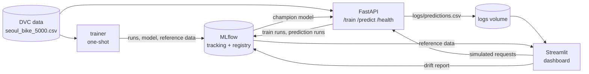
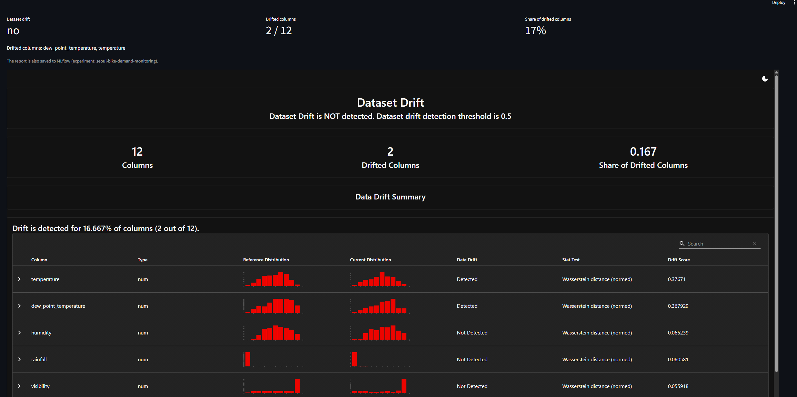
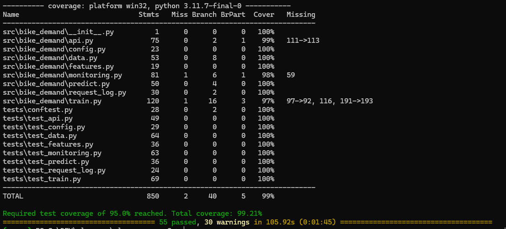
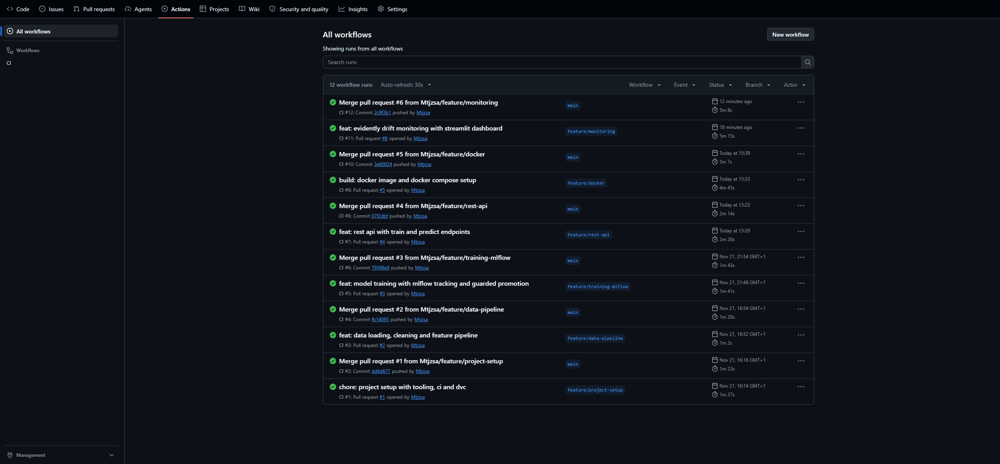

# Seoul Bike Sharing Demand – MLOps semester project

Hourly bike rental demand prediction (regression) with a complete, automated MLOps pipeline:
DVC-versioned data, MLflow experiment tracking and model registry, a FastAPI REST API, Evidently
drift monitoring in a Streamlit dashboard, Docker Compose deployment and GitHub Actions CI.

**Author:** Józsa Máté Szabolcs (RAPC9Y) – Óbuda University, MLSecOps course, 2026

## Contents

1. [Quick start (Docker)](#quick-start-docker)
2. [Architecture](#architecture)
3. [Dataset](#dataset)
4. [Data pipeline](#data-pipeline)
5. [Training and model registry (MLflow)](#training-and-model-registry-mlflow)
6. [REST API (FastAPI)](#rest-api-fastapi)
7. [Monitoring (Evidently + Streamlit)](#monitoring-evidently--streamlit)
8. [Quality checks and CI](#quality-checks-and-ci)
9. [Git workflow](#git-workflow)
10. [Local development setup](#local-development-setup)
11. [Project structure](#project-structure)
12. [Screenshots](#screenshots)
13. [Use of AI](#use-of-ai)
14. [Known limitations and technical debt](#known-limitations-and-technical-debt)

## Quick start (Docker)

```powershell
dvc pull                      # restores the datasets (or copy data/seoul_bike_5000.csv manually)
docker compose up --build
```

| Service     | URL                        | Description                                                                                         |
| ----------- | -------------------------- | --------------------------------------------------------------------------------------------------- |
| `mlflow`    | http://localhost:5000      | MLflow tracking server + model registry (SQLite + artifacts on a Docker volume)                     |
| `trainer`   | –                          | one-shot job: trains the first model if there is no champion yet (`--skip-if-champion`), then exits |
| `api`       | http://localhost:8000/docs | FastAPI REST API (`/train`, `/predict`, `/health`), Swagger UI                                      |
| `streamlit` | http://localhost:8501      | monitoring dashboard with the Evidently drift report                                                |

All services use the same image (`Dockerfile`, Python 3.11 slim, non-root user).
`docker compose down -v` removes the containers and the volumes (MLflow history and request logs).

## Architecture



The business logic is in the `bike_demand` package (`src/`); the Streamlit app is only a thin UI layer.

| Module        | Responsibility                                                                     |
| ------------- | ---------------------------------------------------------------------------------- |
| `config`      | column names, feature lists, settings from environment variables                   |
| `data`        | loading, schema validation, cleaning, train/test split, CLI (DVC stage)            |
| `features`    | date features, preprocessing, scikit-learn pipeline                                |
| `train`       | hyperparameter selection, MLflow logging, registration, guarded champion promotion |
| `predict`     | loading and serving the champion model, logging predictions to MLflow              |
| `request_log` | CSV logs of the `/predict` and `/train` requests                                   |
| `api`         | FastAPI application                                                                |
| `monitoring`  | Evidently drift report, request simulator                                          |

## Dataset

[Seoul Bike Sharing Demand](https://archive.ics.uci.edu/dataset/560/seoul+bike+sharing+demand)
(UCI Machine Learning Repository, CC BY 4.0, DOI: 10.24432/C5F62R) – hourly bike rentals in Seoul
(Dec 2017 – Nov 2018) with weather and calendar data.

| File                                      | Description                                            | Versioned with |
| ----------------------------------------- | ------------------------------------------------------ | -------------- |
| `data/raw/SeoulBikeData.csv`              | original UCI file, 8,760 rows, cp1252 encoded          | DVC            |
| `data/seoul_bike_5000.csv`                | random sample of 5,000 rows (`random_state=42`), UTF-8 | DVC            |
| `data/processed/seoul_bike_processed.csv` | cleaned dataset (output of `dvc repro`)                | DVC            |

The sampling is documented and reproducible in
[`notebooks/01_dataset_sampling.ipynb`](notebooks/01_dataset_sampling.ipynb).
Target variable: `Rented Bike Count` (`rented_bike_count`) – regression.

## Data pipeline

The cleaning step is a DVC pipeline stage (`dvc.yaml`), so the processed dataset is reproducible:

```powershell
dvc repro           # runs: python -m bike_demand.data <sample> <processed>
dvc push
```

| Step       | Function                      | What it does                                                                                        |
| ---------- | ----------------------------- | --------------------------------------------------------------------------------------------------- |
| Load       | `data.load_csv`               | reads the CSV (UTF-8, or cp1252 for the original UCI file)                                          |
| Clean      | `data.clean`                  | snake_case columns, schema validation, date parsing, type coercion, drops invalid / duplicated rows |
| Features   | `features.add_date_features`  | month, day of week, weekend flag from the date                                                      |
| Preprocess | `features.build_preprocessor` | standard scaling (numeric) + one-hot encoding (categorical, unknown categories ignored)             |

The date features are part of the model pipeline, so the served model accepts the raw API records.

## Training and model registry (MLflow)

```powershell
python -m bike_demand.train                     # or: POST /train
```

`bike_demand.train` implements the automatic model improvement and degradation protection:

1. **Hyperparameter selection** – every candidate of the random forest parameter grid is evaluated
   with 3-fold cross-validation as a nested MLflow run; the one with the lowest CV RMSE is selected.
2. **Evaluation and registration** – the selected model is trained, evaluated on a held-out test set
   (RMSE, MAE, R²) and registered in the MLflow model registry (`seoul-bike-demand-model`).
3. **Guarded promotion** – the new version only receives the `champion` alias (the version served by
   the API) if its test RMSE is not worse than the current champion's. Every version is tagged with
   `promoted=true/false` and the previous champion's RMSE.

Logged artifacts: the model (with signature) and the training data as `reference/reference.csv`,
the reference dataset of the drift report. Result: test RMSE ≈ 184 rentals/hour, R² ≈ 0.915.

## REST API (FastAPI)

```powershell
uvicorn bike_demand.api:app --reload --port 8000    # Swagger UI: http://localhost:8000/docs
```

| Endpoint        | Description                                                                                                              |
| --------------- | ------------------------------------------------------------------------------------------------------------------------ |
| `GET /health`   | status, whether a model is loaded and its version                                                                        |
| `POST /train`   | retrains (hyperparameter selection, MLflow logging); the new version is only served if it is not worse than the champion |
| `POST /predict` | predicts hourly rentals for 1–1000 records with the champion model                                                       |

Every request is logged:

- `/predict`: inputs + predictions appended to `logs/predictions.csv` (input of the Evidently drift report)
  and saved as an MLflow run artifact in the `seoul-bike-demand-predictions` experiment,
- `/train`: result appended to `logs/training.csv`; the model and the reference data are MLflow artifacts.

Input validation (Pydantic): value ranges (e.g. `hour` 0–23) and allowed categories; invalid input → `422`,
no trained model yet → `503`.

## Monitoring (Evidently + Streamlit)

Dashboard: http://localhost:8501 (`app/streamlit_app.py`).

1. **API status** – `/health` of the REST API.
2. **Request simulation** – random dataset rows are sent to `/predict`; a temperature shift simulates data drift.
3. **Evidently data drift report** – reference: the champion's training data (MLflow artifact
   `reference/reference.csv`), current: all logged `/predict` requests (`logs/predictions.csv`).
   The summary metrics and the HTML report are also logged to MLflow (`seoul-bike-demand-monitoring`).

Evidently flags each column separately; _dataset drift_ is only reported if at least 50 % of the columns
drift. Example: a +10 °C shift → `temperature` and `dew_point_temperature` drift (2 / 12 columns).

## Quality checks and CI

| Check                                             | Tool                    | Command                | Runs automatically              |
| ------------------------------------------------- | ----------------------- | ---------------------- | ------------------------------- |
| PEP8 (line length 120)                            | flake8                  | `flake8`               | pre-commit hook, GitHub Actions |
| Whitespace, YAML/TOML, large files                | pre-commit-hooks        | –                      | pre-commit hook, GitHub Actions |
| Commit message format                             | conventional-pre-commit | –                      | commit-msg hook                 |
| Type checking (standard mode, `src/`)             | pyright                 | `pyright`              | GitHub Actions                  |
| Tests + coverage (min. 95 %, `src/` and `tests/`) | pytest, coverage        | `pytest --cov`         | GitHub Actions                  |
| Docker image build + smoke test                   | Docker Compose          | `docker compose build` | GitHub Actions                  |

Current state: 55 tests, coverage 99 %, 0 flake8 and 0 pyright errors.
The tests use synthetic data and a temporary SQLite MLflow store, so they need neither the dataset nor a server.
`# pragma: no cover` is only used for the `if __name__ == "__main__"` entry points (justified next to the code).

Workflow (`.github/workflows/ci.yml`), on every pull request and push to `main`:

1. `quality` – pre-commit hooks, pyright, pytest with coverage (report uploaded as an artifact),
2. `docker` – builds the image, starts `mlflow` and `api`, checks their `/health` endpoints.

## Git workflow

- [Conventional Commits](https://www.conventionalcommits.org/): `<type>(<scope>): <description>`,
  e.g. `feat(api): add predict endpoint` (types: `feat`, `fix`, `test`, `docs`, `refactor`, `chore`, `ci`,
  `build`), enforced by a commit-msg hook.
- Every change is made on a `feature/*` branch and merged into `main` via a pull request with a merge
  commit (the branch history is preserved). `main` is protected: pull request required, no force push.
- Feature branches: `project-setup`, `data-pipeline`, `training-mlflow`, `rest-api`, `docker`,
  `monitoring`, `final-docs`.
- Fixes found by the tools are visible in the history as separate `fix:` commits.

## Local development setup

Windows, PowerShell, Python 3.11:

```powershell
py -3.11 -m venv .venv
.venv\Scripts\Activate.ps1
pip install -r requirements.txt -r requirements-dev.txt
pip install -e .    # installs the bike_demand package from src/ (editable)
pre-commit install
dvc pull
```

Running the services without Docker (separate terminals):

```powershell
mlflow server --backend-store-uri sqlite:///mlflow.db --artifacts-destination ./mlartifacts --host 127.0.0.1 --port 5000
uvicorn bike_demand.api:app --reload --port 8000
streamlit run app/streamlit_app.py
```

## Project structure

```
├── .github/workflows/ci.yml     GitHub Actions (quality + docker jobs)
├── app/streamlit_app.py         Streamlit dashboard (thin UI layer)
├── data/                        datasets (DVC-tracked, *.dvc files in Git)
├── docs/screenshots/            screenshots of the running system
├── notebooks/                   dataset sampling notebook
├── src/bike_demand/             business logic (config, data, features, train, predict, request_log, api, monitoring)
├── tests/                       pytest tests (synthetic data, temporary MLflow store)
├── Dockerfile, docker-compose.yml, .dockerignore
├── dvc.yaml, dvc.lock           DVC pipeline (preprocess stage)
├── pyproject.toml, .flake8      project metadata, pytest/coverage/pyright and flake8 configuration
├── .pre-commit-config.yaml      Git hooks
└── requirements.txt, requirements-dev.txt   exact dependency versions
```

## Screenshots

| What                                                 | File                                       |
| ---------------------------------------------------- | ------------------------------------------ |
| MLflow – experiment with training and candidate runs | `docs/screenshots/mlflow_experiments.png`  |
| MLflow – model registry with the champion alias      | `docs/screenshots/mlflow_models.png`       |
| REST API in operation (Swagger) – `/predict`         | `docs/screenshots/api_predict.png`         |
| REST API in operation (Swagger) – `/train`           | `docs/screenshots/api_train.png`           |
| Docker containers in operation                       | `docs/screenshots/docker_containers.png`   |
| Streamlit dashboard with the Evidently report        | `docs/screenshots/streamlit_evidently.png` |
| Test results with coverage                           | `docs/screenshots/pytest_coverage.png`     |
| GitHub Actions CI run                                | `docs/screenshots/github_actions.png`      |






## Use of AI

An AI assistant (Claude, Anthropic) was used throughout the project, as recommended in the assignment:

- **Planning:** dataset selection, architecture, splitting the work into feature branches and commits.
- **Code and configuration drafts:** the modules in `src/`, the tests, the Dockerfile, Docker Compose,
  the GitHub Actions workflow, the pre-commit and tool configuration, the README.
- **Debugging:** dependency conflicts (`pathspec` with DVC, `sqlalchemy` with MLflow), pyright type errors
  with pandas/MLflow, a coverage data combine error caused by MLflow subprocesses.

How: the assistant proposed the code step by step; I created the files, ran every check locally
(pytest, coverage, flake8, pyright, Docker), reported the errors back, applied the fixes and made all
commits, pull requests and merges myself. The screenshots show the system running on my machine.
I reviewed the generated code and can explain every component.

## Known limitations and technical debt

- **Airflow (extra) was not implemented**, and pyright runs in standard mode (the strict mode extra
  was not attempted) – a deliberate scope decision because of time constraints.
- The **DVC remote is a local folder** (`../dvc-storage`), so `dvc pull` only works on my machine; the
  dataset files are submitted in the ZIP file as well.
- The train/test split is random; a time-based split would be more realistic for a time series.
- `/train` is synchronous (~30 s with the default parameter grid); a background job would scale better.
- The MLflow server (gunicorn sync workers) may log `WORKER TIMEOUT` messages when a browser keeps an idle
  connection open; the worker is restarted automatically and no data is lost.
- Drift detection does not trigger retraining automatically: the logged requests have no labels, so
  retraining on them is not possible. Retraining on new labelled data is protected by the champion guard.
