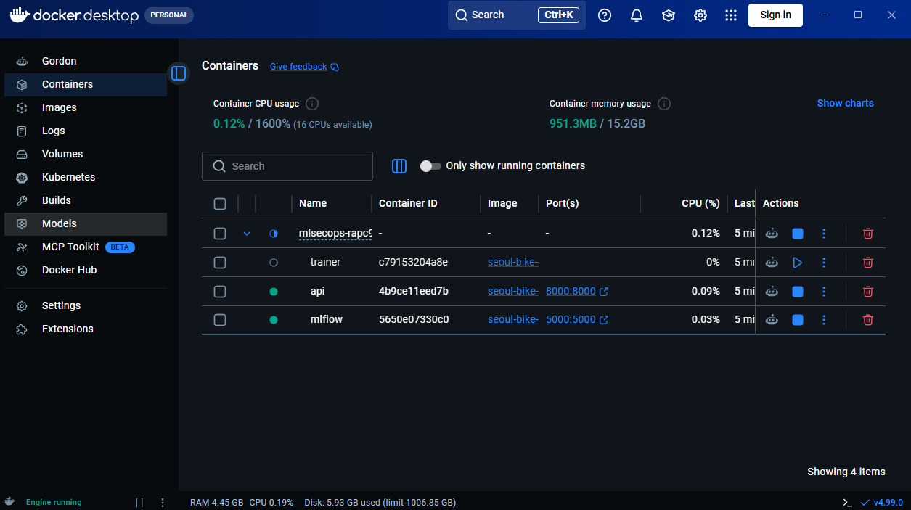
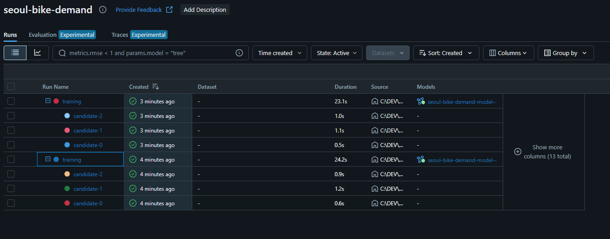
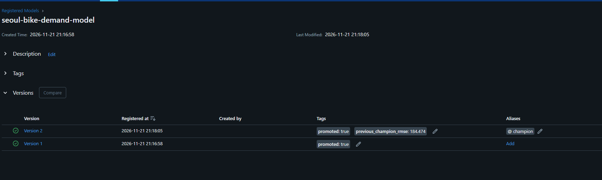
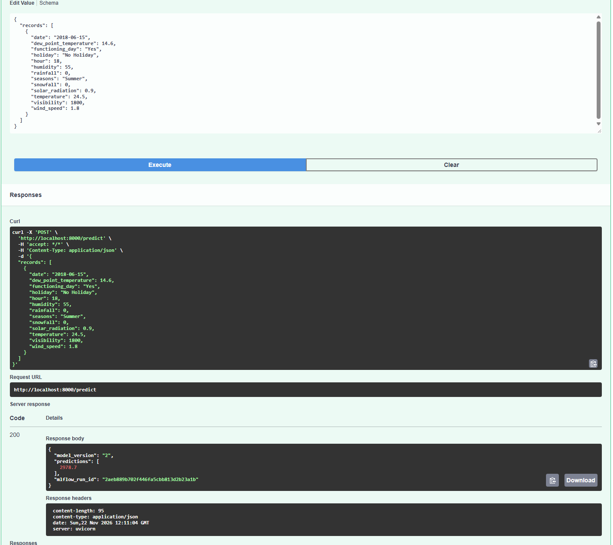
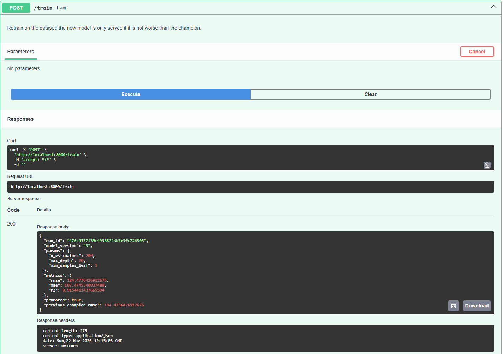

# Seoul Bike Sharing Demand – MLOps semester project

Hourly bike rental demand prediction (regression) on the
[Seoul Bike Sharing Demand](https://archive.ics.uci.edu/dataset/560/seoul+bike+sharing+demand)
dataset (UCI, CC BY 4.0, DOI: 10.24432/C5F62R), randomly sampled to 5,000 rows.

Author: Józsa Máté Szabolcs (RAPC9Y) – Óbuda University, MLSecOps course

> Work in progress – the full documentation (architecture, API, Docker, monitoring) will follow.

## Dataset

| File                         | Description                                            | Versioned with |
| ---------------------------- | ------------------------------------------------------ | -------------- |
| `data/raw/SeoulBikeData.csv` | original UCI file, 8,760 rows, cp1252 encoded          | DVC            |
| `data/seoul_bike_5000.csv`   | random sample of 5,000 rows (`random_state=42`), UTF-8 | DVC            |

The sampling is documented and reproducible in
[`notebooks/01_dataset_sampling.ipynb`](notebooks/01_dataset_sampling.ipynb).

Target variable: `Rented Bike Count` (`rented_bike_count`) – regression.

## Quick start (Docker)

```powershell
dvc pull                      # restores data/seoul_bike_5000.csv
docker compose up --build
```

| Service   | URL                        | Description                                                                                         |
| --------- | -------------------------- | --------------------------------------------------------------------------------------------------- |
| `mlflow`  | http://localhost:5000      | MLflow tracking server + model registry (SQLite + artifacts on a Docker volume)                     |
| `trainer` | –                          | one-shot job: trains the first model if there is no champion yet (`--skip-if-champion`), then exits |
| `api`     | http://localhost:8000/docs | FastAPI REST API (`/train`, `/predict`, `/health`)                                                  |

All services use the same image (`Dockerfile`, non-root user). Request logs are stored on the `logs` volume.
`docker compose down -v` removes the containers and the volumes (MLflow history and logs).



## Local development setup (Windows, PowerShell)

```powershell
py -3.11 -m venv .venv
.venv\Scripts\Activate.ps1
pip install -r requirements.txt -r requirements-dev.txt
pip install -e .    # installs the bike_demand package from src/ (editable)
pre-commit install
dvc pull            # restores the datasets from the DVC remote
```

## Data pipeline

The cleaning step is a DVC pipeline stage (`dvc.yaml`), so the processed dataset is reproducible:

```powershell
dvc repro           # runs: python -m bike_demand.data <sample> <processed>
dvc push
```

| Step       | Module                                    | What it does                                                                                        |
| ---------- | ----------------------------------------- | --------------------------------------------------------------------------------------------------- |
| Load       | `bike_demand.data.load_csv`               | reads the CSV (UTF-8, or cp1252 for the original UCI file)                                          |
| Clean      | `bike_demand.data.clean`                  | snake_case columns, schema validation, date parsing, type coercion, drops invalid / duplicated rows |
| Features   | `bike_demand.features.add_date_features`  | month, day of week, weekend flag from the date                                                      |
| Preprocess | `bike_demand.features.build_preprocessor` | standard scaling (numeric) + one-hot encoding (categorical)                                         |

Output: `data/processed/seoul_bike_processed.csv` (5,000 rows, 14 columns).

## Quality checks

| Check                            | Tool                    | Command        | Where it runs automatically     |
| -------------------------------- | ----------------------- | -------------- | ------------------------------- |
| PEP8 (line length 120)           | flake8                  | `flake8`       | pre-commit hook, GitHub Actions |
| Commit message format            | conventional-pre-commit | –              | commit-msg hook                 |
| Type checking (standard, `src/`) | pyright                 | `pyright`      | GitHub Actions                  |
| Tests + coverage (min. 95 %)     | pytest, coverage        | `pytest --cov` | GitHub Actions                  |

All local hooks, including the manual ones:

```powershell
pre-commit run --all-files
pre-commit run --hook-stage manual --all-files
```

## Training and model registry (MLflow)

```powershell
mlflow server --backend-store-uri sqlite:///mlflow.db --artifacts-destination ./mlartifacts --host 127.0.0.1 --port 5000
python -m bike_demand.train      # in a second terminal
```

`bike_demand.train` implements the automatic model improvement and degradation protection:

1. **Hyperparameter selection** – every candidate of the random forest parameter grid is evaluated
   with 3-fold cross-validation as a nested MLflow run; the one with the lowest CV RMSE is selected.
2. **Evaluation and registration** – the selected model is trained, evaluated on a held-out test set
   (RMSE, MAE, R²) and registered in the MLflow model registry (`seoul-bike-demand-model`).
3. **Guarded promotion** – the new version only receives the `champion` alias (the version served by
   the API) if its test RMSE is not worse than the current champion's. Every version is tagged with
   `promoted=true/false` and the previous champion's RMSE.

Logged artifacts: the model (with signature) and the training data as `reference/reference.csv`,
which is the reference dataset of the Evidently drift report.




## REST API (FastAPI)

```powershell
uvicorn bike_demand.api:app --reload --port 8000    # Swagger UI: http://localhost:8000/docs
```

| Endpoint        | Description                                                                                                                             |
| --------------- | --------------------------------------------------------------------------------------------------------------------------------------- |
| `GET /health`   | status, whether a model is loaded and its version                                                                                       |
| `POST /train`   | retrains on the dataset (hyperparameter selection, MLflow logging); the new version is only served if it is not worse than the champion |
| `POST /predict` | predicts hourly rentals for 1–1000 records with the champion model                                                                      |

Every request is logged:

- `/predict`: inputs + predictions appended to `logs/predictions.csv` (input of the Evidently drift report)
  and saved as an MLflow run artifact in the `seoul-bike-demand-predictions` experiment,
- `/train`: result appended to `logs/training.csv`, the model and the reference data are MLflow artifacts.

Input validation (Pydantic): value ranges (e.g. `hour` 0–23) and allowed categories; invalid input → `422`,
no trained model yet → `503`.




## Commit message convention

[Conventional Commits](https://www.conventionalcommits.org/): `<type>(<scope>): <description>`,
e.g. `feat(api): add predict endpoint`. Types used: `feat`, `fix`, `test`, `docs`, `refactor`,
`chore`, `ci`, `build`, `style`. Work is done on `feature/*` branches and merged into `main`
via pull requests only (protected branch).
